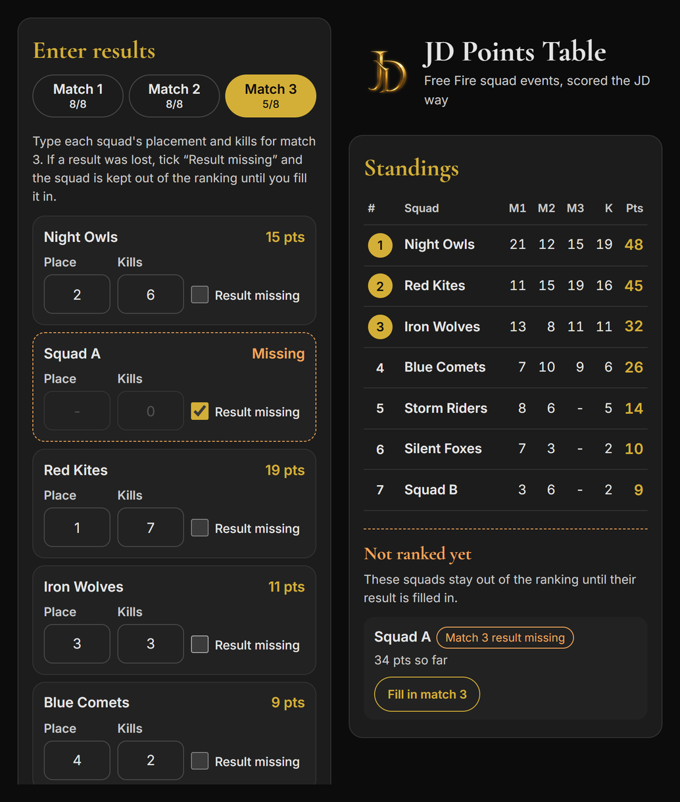

<p align="center">
  
</p>

# JD Points Table

[](https://github.com/AyerPrabin/jd-points-table/actions/workflows/ci.yml)

**Live:** https://ayerprabin.github.io/jd-points-table/

A small web app for scoring Free Fire squad events on a phone. The host types in each
squad's placement and kills for every match, and the app keeps a live standings table,
sorts out ties, and gives you the result as WhatsApp text, a CSV file or an image.



## Why I built it

I run JD Esports Arena, a small platform where we host Free Fire tournaments. Most
events are three matches, and the host works out the points by hand while the event is
still going.

At one recent event, the host's app crashed during match 3 and the placements for that
match were lost. Working the totals out by hand, there was no clean way to say "this
squad's result is missing". Either the squad got 0 for that match, which made the order
wrong, or the host had to remember that some totals could not be trusted yet.

So I wanted a tool that:

- uses the same scoring as JD, so nobody has to do sums
- copes with a missing result by holding that squad out of the ranking and saying why,
  instead of quietly giving it zero
- works on a cheap Android phone at 360px wide, with nothing to install

## What it does

- Add the squads for the event (up to 25), and name the event.
- Enter placement and kills for each squad, one match at a time. Each match tab shows
  how many squads have a result so far.
- Tick **Result missing** for a squad when its result was lost. That squad is shown in a
  separate "Not ranked yet" list with its points so far, and the other squads are ranked
  without it. When the result turns up, fill it in and the squad moves back into the
  table.
- Warns about mistakes in a match, for example two squads both marked 1st, or a
  placement higher than the number of squads.
- Copy the standings as text for a WhatsApp group, download them as CSV, or save a PNG
  image of the table.
- Everything is saved in the browser's localStorage, so a refresh or a closed tab does
  not lose the event. If the browser blocks storage (some private modes), the app says so.

There is a **Load sample event** button with made-up squads if you want to try it.

## Scoring

These are the rules we use on JD Esports Arena. They are all in
[`src/config.ts`](src/config.ts), so changing them means changing one file.

Each match, a squad gets **placement points + 1 point per kill**.

| Place | Points |
| ----- | ------ |
| 1st   | 12     |
| 2nd   | 9      |
| 3rd   | 8      |
| 4th   | 7      |
| 5th   | 6      |
| 6th   | 5      |
| 7th   | 4      |
| 8th   | 3      |
| 9th   | 2      |
| 10th  | 1      |
| 11th+ | 0      |

### Tie-breaks

If two squads have the same total, they are compared in this order:

1. Total kills (more is better)
2. Best placement in any single match (lower is better)
3. Placement in the last match (lower is better). If that is also level, it goes back
   to match 2, then match 1.

A squad that did not play a match counts as worse than any placement in it. If two
squads are still level after all of that (in practice only when neither has a result
yet), they share the rank, so you get 1, 2, 2, 4, and they are listed by name.

### Missing and invalid results

Each squad has one of three states per match: not entered yet, played (placement and
kills), or **missing**. "Not entered yet" is normal during an event, so those squads stay
in the live table. "Missing" means the result was lost, so the squad is held back from
the ranking until someone fills it in. A result with an impossible value (such as
placement 0) is held back in the same way.

## Running it

You need Node.js 24 (any recent LTS should work).

```bash
npm install
npm run dev        # http://localhost:5173/jd-points-table/
```

Other scripts:

```bash
npm run build      # type check and build into dist/
npm run preview    # serve the built app
npm run lint       # ESLint, including jsx-a11y rules
npm run format     # Prettier
npm run typecheck  # tsc in strict mode
```

## Tests

```bash
npm test           # Vitest: unit and component tests
npm run e2e        # Playwright: builds the app and runs the main flow in Chromium
```

- `src/scoring.test.ts` covers the points table, every tie-break step, shared ranks,
  missing and invalid results, and the warnings for duplicate placements.
- `src/export.test.ts`, `src/storage.test.ts` and `src/eventState.test.ts` cover the CSV
  and WhatsApp text, saving and loading (including broken JSON and blocked storage),
  and the state changes.
- `src/App.test.tsx` uses Testing Library to drive the UI the way a host would, finding
  inputs by their labels.
- `e2e/main-flow.spec.ts` runs a whole three-match event at 360px wide in a real browser,
  marks one result missing, fills it in later, copies the text, downloads the CSV and
  reloads the page to check nothing was lost. It also checks the page never scrolls
  sideways.

On my laptop I have no room for another browser, so I run the e2e test against Edge
with `PW_CHANNEL=msedge npm run e2e`. CI uses Playwright's own Chromium.

GitHub Actions runs lint, format check, type check, unit tests, build and the e2e test
on every push, then deploys `main` to GitHub Pages.

## Design notes

- **Scoring is plain functions.** `src/scoring.ts` has no React and does not touch
  storage. It takes a list of squads and returns the ranked rows and the held-back rows.
  That made it easy to test every tie-break on its own, and I can move the same code to
  the JD backend later without changes.
- **Missing is its own state, not zero.** The bug at the real event was that a lost
  result looked the same as a bad result. Keeping `pending`, `played` and `missing`
  separate in the type means the UI and the export both have to deal with it.
- **Small state.** One `useReducer` holds the event. The reducer is also a plain function
  with its own tests. The saved data is checked when it is loaded, so an old or
  hand-edited save cannot crash the app.
- **Phone first.** Each squad gets a card with large inputs and a numeric keyboard
  (`inputmode="numeric"`) rather than a wide grid. Every input has a real label, which
  also made the tests simpler to write. Colours were picked for contrast on black: the
  gold `#D4AF37` on `#0C0C0C` is well above the WCAG AA ratio.
- **CSV safety.** Squad names that start with `=`, `+`, `-` or `@` get a leading quote in
  the CSV so a spreadsheet does not run them as formulas.

## Limitations

- It is fixed at three matches per event, which is what JD uses. The number is in the
  config, but the UI has not been tested with other values.
- Data lives in one browser on one phone. If the host's phone dies, the event is gone,
  and two people cannot enter results at the same time.
- It only does squad events. Solo and duo events, and multi-stage events with groups and
  a final, are not covered.
- The share image is drawn on a canvas with system fonts, so it looks slightly different
  on each phone.

## What I would add next

- An optional backend (Supabase, which JD already uses) so a second admin can follow
  the table live and the host's phone is not the only copy.
- Reading placements from a screenshot of the Free Fire results screen.
- Settings for match count and points table per event.
- Support for group stages that feed into a final.

## Licence

MIT. See [LICENSE](LICENSE).
